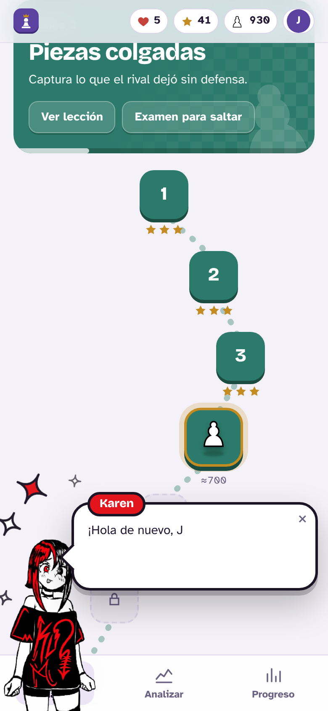
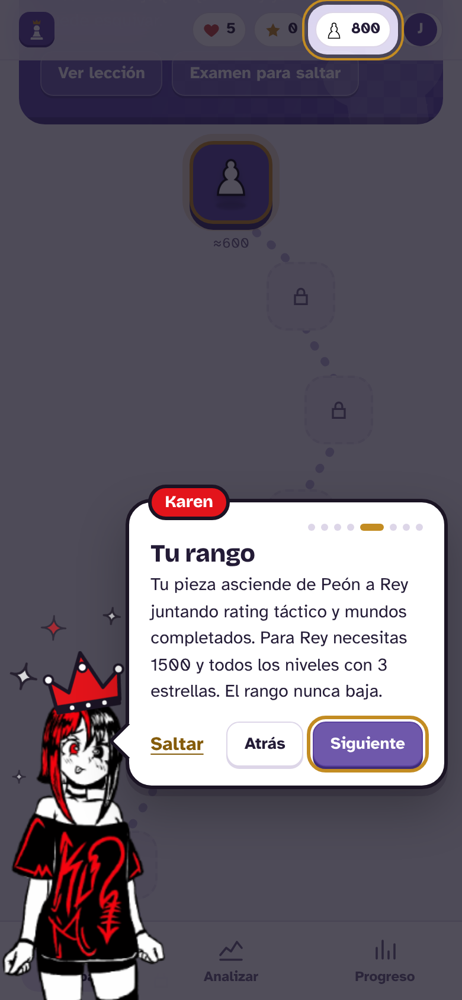
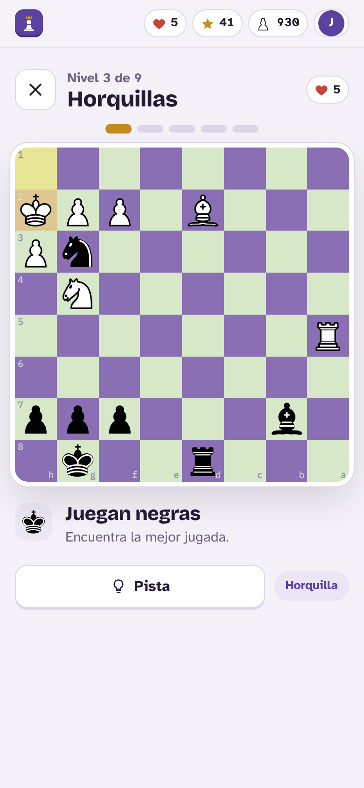
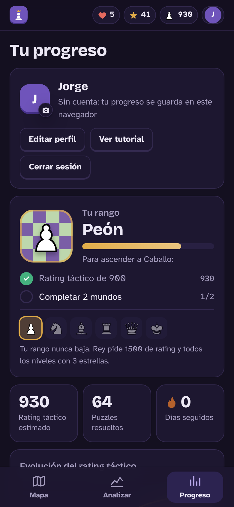
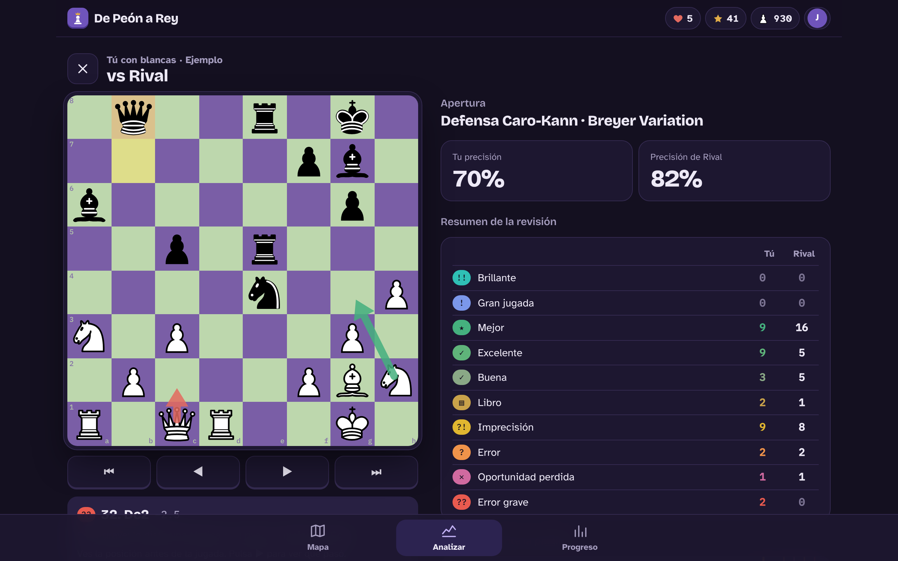

  

<h1 align="center">De Peón a Rey</h1>

  Entrenador de táctica de ajedrez gratuito, pensado para pasar de 600 a 1500 de elo. 
  Mundos de puzzles por niveles, un reto diario y la revisión de tus partidas con Stockfish, todo en el navegador.

  <a href="https://jorgepizanosaucedo-crypto.github.io/de-peon-a-rey/"><strong>Abrir la app</strong></a>

<table>
  <tr>
    <td></td>
    <td></td>
  </tr>
  <tr>
    <td></td>
    <td></td>
  </tr>
</table>

  

## Qué hace

- **Mapa de niveles:** siete mundos de táctica (mate en 1, piezas colgadas, defensa, horquillas, mate en 2, clavadas y táctica mixta). Repetir un nivel trae puzzles nuevos.
- **Rangos de Peón a Rey:** tu pieza sube con rating táctico y mundos completados. Para Rey: 1500 y todos los niveles con 3 estrellas.
- **Defensa:** puzzles donde primero descubres qué amenaza tu rival y luego te defiendes.
- **Reto diario:** cinco puzzles iguales para todos cada día, con resultado para compartir.
- **Revisión de partidas:** trae tus partidas de Chess.com o Lichess, Stockfish califica cada jugada como lo hace Chess.com y tus errores se vuelven puzzles.
- **Karen, la mascota:** da el tutorial y te aconseja de vez en cuando; cambia de ánimo y de accesorios según lo que dice.
- **Detalles:** música tranquila en los menús, foto de perfil, varios perfiles en la misma computadora y cuentas opcionales para sincronizar entre dispositivos.

## Cómo está hecho

- Página estática en HTML, CSS y JavaScript, sin frameworks ni servidor.
- Stockfish 17.1 en WebAssembly dentro de un Web Worker; tablero propio en SVG.
- Sonidos y música generados con Web Audio, sin archivos de audio.
- 1145 puzzles generados con Stockfish y revisados para que tengan una solución única.
- Cuentas opcionales con Firebase (Google o correo).

## Seguridad y privacidad

Sin anuncios, analíticas ni cookies. Sin cuenta, tu progreso nunca sale de tu navegador. La página solo ejecuta su propio código (CSP) y no depende de servidores ajenos. Detalles en [`SECURITY.md`](SECURITY.md).

## Autor

Hecho por **Jorge Luis Pizano Saucedo** ([@jorgepizanosaucedo-crypto](https://github.com/jorgepizanosaucedo-crypto)).

Karen, la mascota, fue ilustrada por **Karen**.

## Créditos y licencias

- Código de De Peón a Rey © 2026 Jorge Luis Pizano Saucedo, bajo GPLv3 ([`LICENSE`](LICENSE)), la misma licencia de Stockfish.
- Karen (personaje e ilustración): todos los derechos reservados, no está bajo la GPLv3 ([`assets/mascota/LICENSE.txt`](assets/mascota/LICENSE.txt)).
- [Stockfish](https://stockfishchess.org/) y [stockfish.js](https://github.com/nmrugg/stockfish.js): GPLv3.
- [chess.js](https://github.com/jhlywa/chess.js): BSD-2. [Firebase JS SDK](https://github.com/firebase/firebase-js-sdk): Apache-2.0.
- Piezas Cburnett, vía cm-chessboard: CC BY-SA 3.0.
- Nombres de aperturas de [lichess-org/chess-openings](https://github.com/lichess-org/chess-openings): CC0.
- Tipografías Bricolage Grotesque, Atkinson Hyperlegible e IBM Plex Mono: SIL Open Font License.

¿Quieres correrlo en tu computadora, generar más puzzles o publicar tu copia? Ve [`DESARROLLO.md`](DESARROLLO.md).
